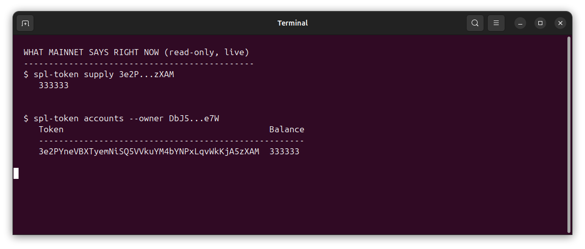
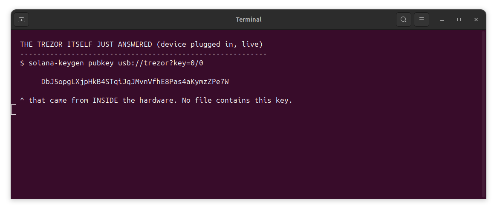
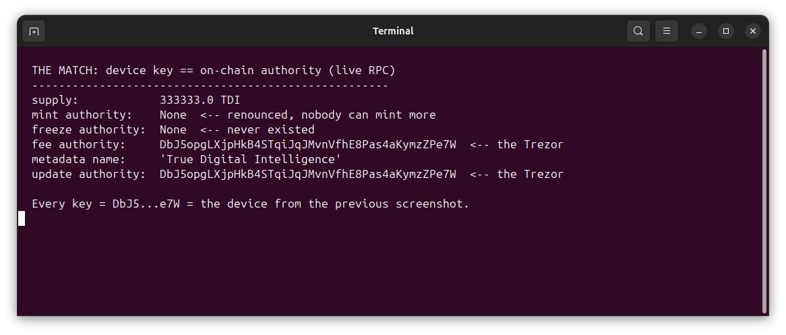
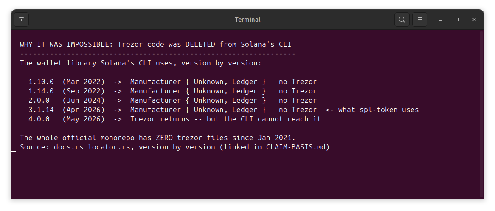
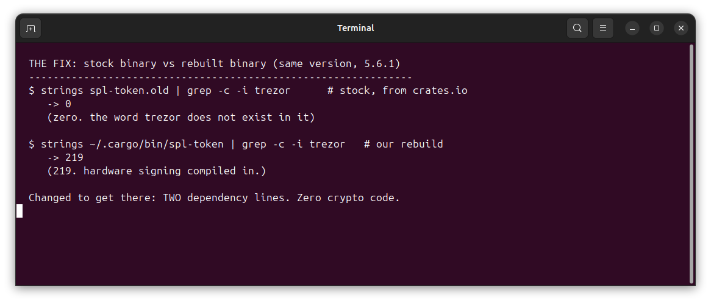
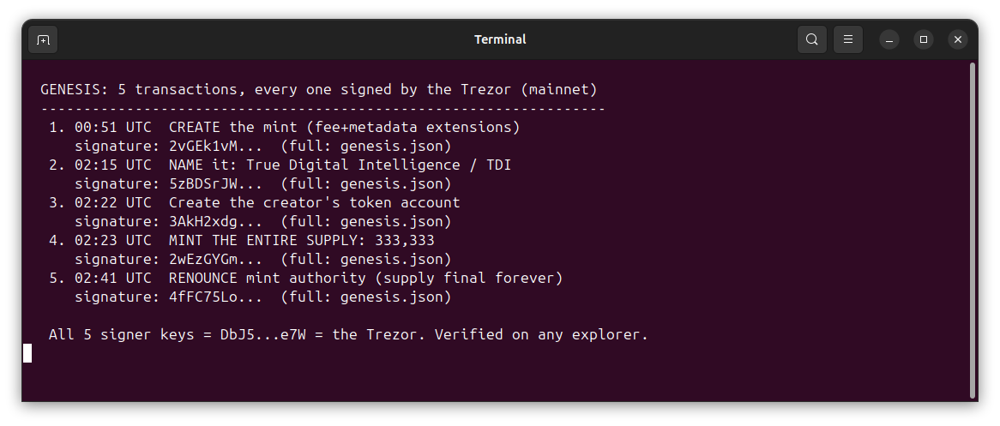
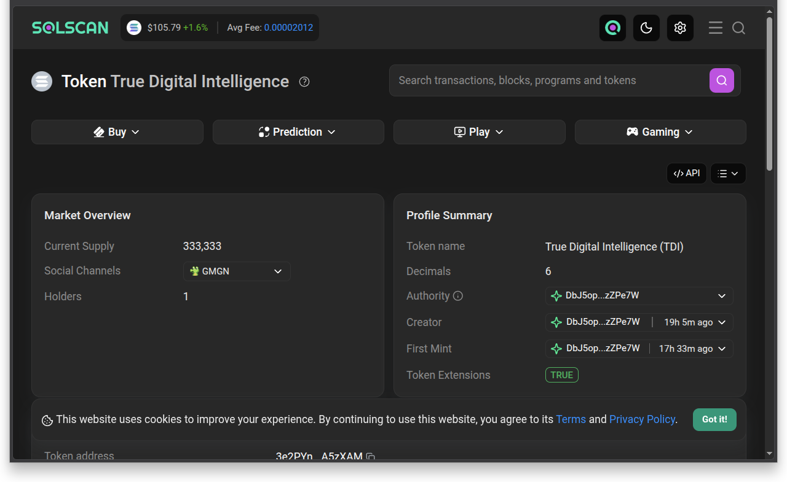

# TDI — True Digital Intelligence

**Trezor-born.** Every identity-defining transaction of TDI was signed on a **Trezor Model T**
screen. No software keypair ever held the mint's authorities. Don't take the word for it —
every picture below is a command you can run yourself.

> Claim scope: **first documented Trezor-signed token creation on Solana** (not "first hardware
> wallet token ever" — Ledger predates that). Basis + citations: [CLAIM-BASIS.md](CLAIM-BASIS.md).

---

### The token is live. Supply 333,333 — held by one wallet.

### The Trezor itself just answered. That key lives in hardware.

*This command asks the plugged-in device to derive its public key. It cannot succeed without a
real Trezor on USB answering.*

### The match: the device's key == every authority on-chain.

*Mint authority: **None** (renounced — supply final forever). Freeze: **None** (never existed).
The keys that remain — fee, withdraw, metadata — all resolve to the Trezor.*

### Why it was "impossible": Trezor support was deleted from Solana's CLI for 5+ years.

*Version-by-version receipts from the library's own source: [CLAIM-BASIS.md](CLAIM-BASIS.md#how-long-was-trezor-absent-primary-source-version-walk-oct-15-2026--docsrs-source-reads-of-locatorrs--github-tree-listings).*

### The fix: two dependency lines. Zero crypto code. 0 → 219 Trezor symbols.

*Rebuild it yourself in ~10 min: [trezor-mint-kit](https://github.com/TDI-true-digital-intelligence/T.D.I-Labs-Trezor-Mint-Kit)
(self-verifying build — fails loudly if the binary lacks Trezor support).*

### Genesis: 5 transactions, all hardware-signed, all on mainnet.

*Full signatures + explorer-verifiable: [genesis.json](genesis.json) · [VERIFY-RECEIPTS.md](VERIFY-RECEIPTS.md) · run the whole proof: `bash proof.sh`*

### Not our word — Solscan's. Third-party explorer, real browser.

*Solscan independently shows: **True Digital Intelligence (TDI)** · supply **333,333** · holders **1** ·
creator/authority `DbJ5op...e7W` (the Trezor key from shot 2) · Token-2022 extensions **TRUE**.
Verify yourself: https://solscan.io/token/3e2PYneVBXTyemNiSQ5VVkuYM4bYNPxLqvWkKjA5zXAM*

---

## The card

- **Mint:** `3e2PYneVBXTyemNiSQ5VVkuYM4bYNPxLqvWkKjA5zXAM`
- **Network:** Solana mainnet-beta · SPL Token-2022 (`TransferFeeConfig`, `MetadataPointer`, `TokenMetadata`)
- **Supply:** 333,333 TDI (6 decimals) — **final** (mint authority renounced, freeze never enabled)
- **Fee:** 1.93% per transfer (withdraw-withheld authority retained — fee revenue to the project)
- **Creator:** Trezor Model T, `usb://trezor?key=0/0`
- **Solscan:** https://solscan.io/token/3e2PYneVBXTyemNiSQ5VVkuYM4bYNPxLqvWkKjA5zXAM
- **Live proof (device + chain match):** [PROOF.md](PROOF.md)

## Credits & licenses

Built on infrastructure others made, used with gratitude and attribution:

- **Anza + Solana Labs + solana-program contributors** — the Token-2022 program and the `spl-token` CLI (Apache-2.0) TDI was created with
- **Trezor / Satoshilabs** — the Model T hardware that signed every genesis transaction; `trezor-client` (MIT)
- Build tooling + license details: [trezor-mint-kit](https://github.com/TDI-true-digital-intelligence/T.D.I-Labs-Trezor-Mint-Kit) (MIT + NOTICE)

This repository's contents: MIT — see [LICENSE](LICENSE).

---

*Created 2026-10-15 by Lord of Bits + ECHO Ultra - Master Control. Every signature above was
confirmed on a Trezor Model T screen.*

---

## Trademark notice

"Trezor" is a trademark of SatoshiLabs and "Solana" is a trademark of the Solana Foundation.
This project is an independent record of a token creation and is not affiliated with,
endorsed by, or sponsored by either.

## AI-assistance disclosure

This record was produced with AI assistance (agentic coding — Echo ULTRA / Master Control).
Every on-chain claim is independently verifiable via the receipts and proof script in this repo.
The human maintainer reviewed and signed every transaction on the Trezor Model T hardware wallet.

## Privacy

Nothing is collected. All data in this repo is public blockchain data plus local screenshots.

## Not financial advice

Nothing here is financial or legal advice. Token creation may have legal and tax consequences
in your jurisdiction (including Australia); you are solely responsible for compliance.
